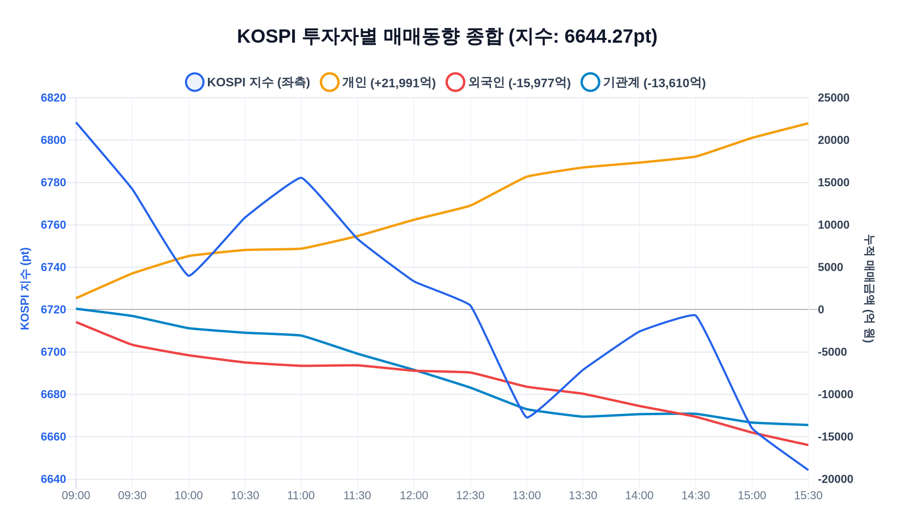
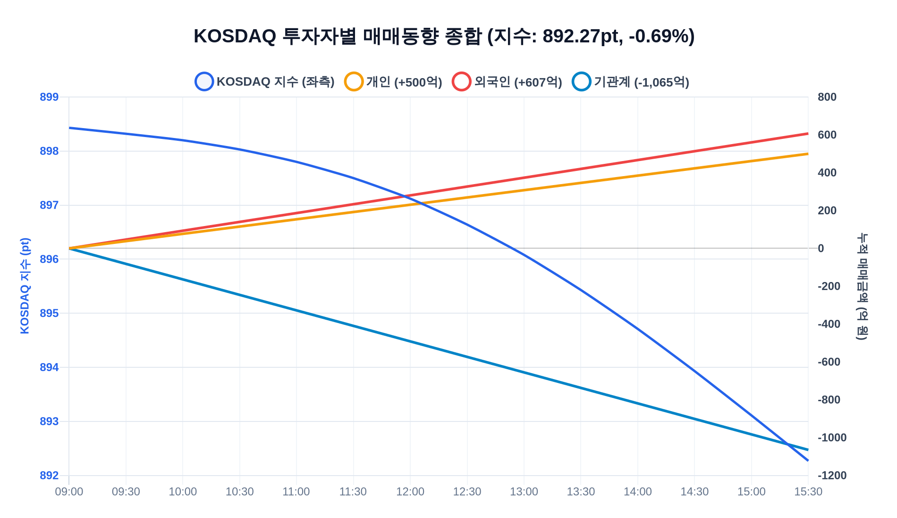
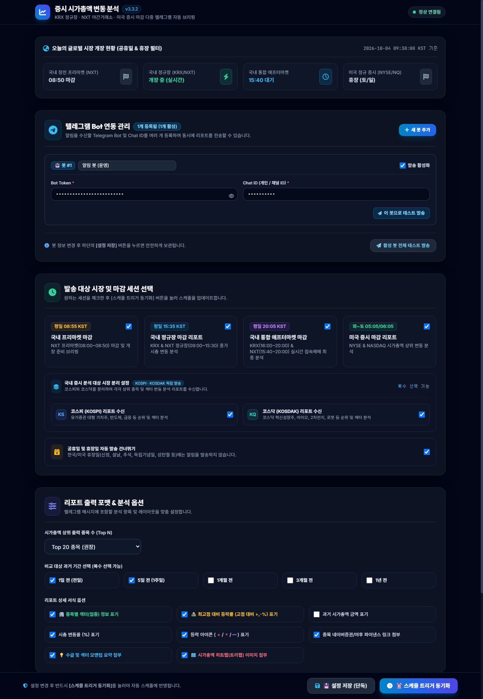
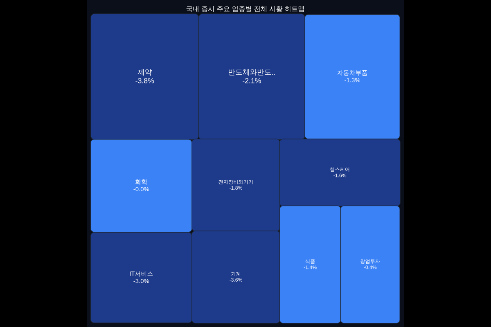
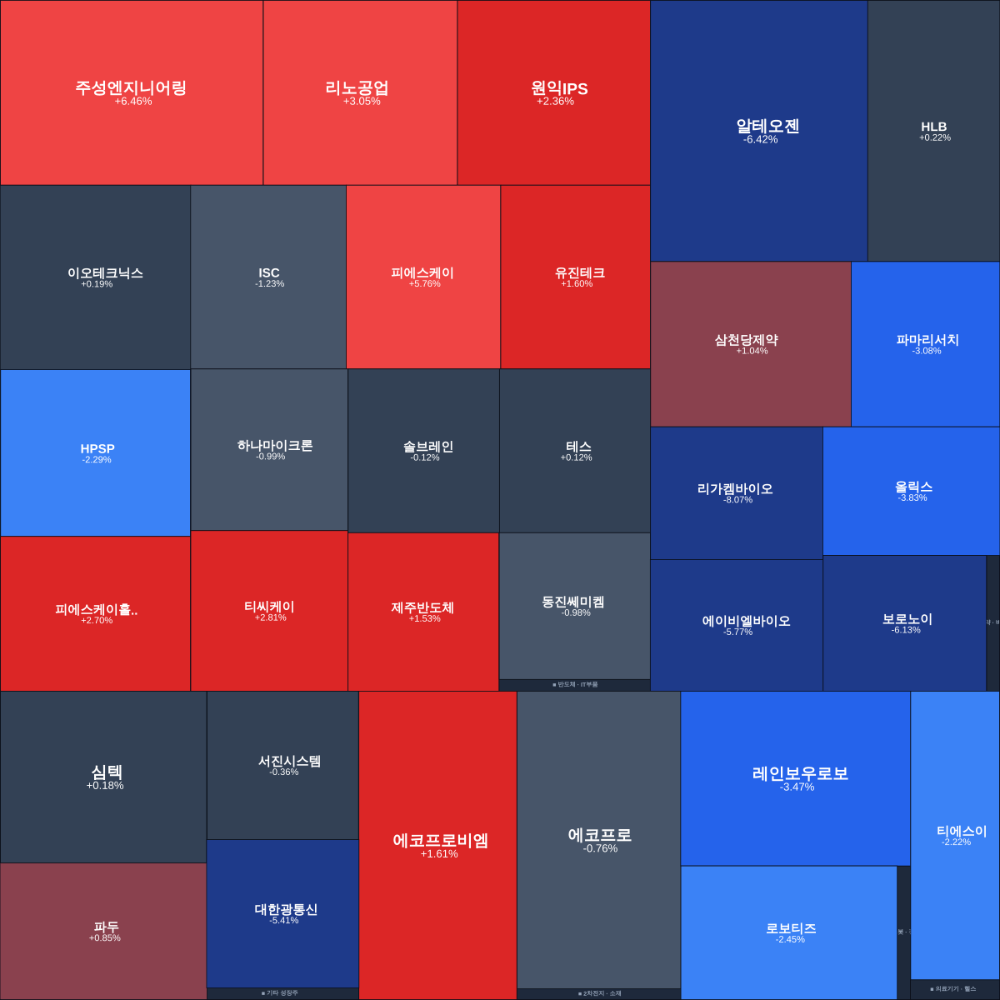
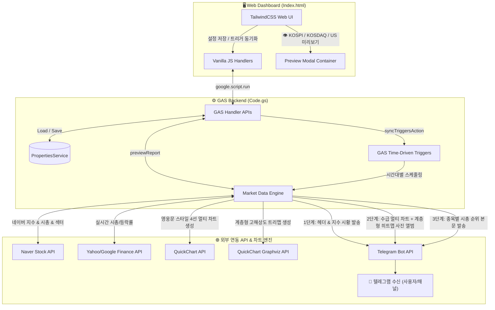

# 📊 증시 시가총액 변동 분석 & 텔레그램 자동 발송 웹 UI (GAS Project)

> **Google Apps Script(GAS)**와 **Modern TailwindCSS Web UI** 기반으로 개발된 한국 증시(NXT 프리마켓 / KRX·NXT 정규장 / 통합 애프터마켓) 및 미국 증시(US 본장) 시가총액 변동 자동 분석 및 텔레그램 리포팅 시스템입니다.

[](https://github.com/moozuknet/StockRankInfo)
[](https://developers.google.com/apps-script)
[](LICENSE)

---

## 📸 대시보드 & 시황 멀티 차트 / 히트맵 스크린샷

### 1) 투자자별 매매동향 종합 멀티라인 차트 (v3.3+)
> 💡 **영웅문 [0251] 스타일 다중축(Dual-Axis) 4선 복합 차트**: **좌측축(지수 pt)**과 **우측축(누적 금액 억 원)** 위에 **KOSPI/KOSDAQ 지수(파랑), 개인(주황), 외국인(빨강), 기관계(청록)** 4개 곡선을 장중 시간대별(09:00~15:30 전 구간 200개 시계열)로 완벽히 재현하여 지수 흐름과 수급 주체의 방향성을 100% 동일하게 한눈에 파악합니다.

| 코스피(KOSPI) 투자자별 종합 차트 | 코스닥(KOSDAQ) 투자자별 종합 차트 |
| :---: | :---: |
|  |  |

### 2) 웹 설정 대시보드 (Web App UI)
> 💡 **v3.4 최신 대시보드 화면**: KOSPI/KOSDAQ 독립 수신, 4대 시장 세션 스케줄러, WICS 섹터 및 최고점 대비 등락률(고점 대비 +,-%) 표기 옵션이 반영된 반응형 UI입니다.



### 3) 🇺🇸 미국 S&P 500 핀비즈(Finviz) 스타일 11대 섹터 전체 종목 히트맵 (v3.4.1 최신)
> 💡 **Finviz 실시간 시세 연동 & 1600x1600 Ultra HD 트리맵**:
> - **11대 섹터 68개 핵심 주도주 타일링**: `TECHNOLOGY`, `COMMUNICATION SERVICES`, `CONSUMER CYCLICAL`, `FINANCIAL`, `HEALTHCARE`, `CONSUMER DEFENSIVE`, `INDUSTRIALS`, `ENERGY`, `UTILITIES`, `REAL ESTATE`, `BASIC MATERIALS` 전 섹터 총망라.
> - **대형 폰트 가독성 극대화 (최소 22pt BOLD 보장)**: 메가캡 **54pt BOLD**, 주요 대형주 **42pt BOLD**로 모바일 화면에서 확대하지 않아도 시원시원하게 종목명과 등락률 열람 가능.
> - **Finviz 500개 종목 실시간 등락률 1:1 파싱 & 네이버 2중 폴백 탑재**.
> - **텔레그램 무손실 Multipart 파일 전송 (`attach://`)**: 나스닥 & S&P 500 지수 차트와 함께 고화질 묶음 사진 앨범으로 자동 발송.

### 4) 코스피(KOSPI) / 코스닥(KOSDAQ) 주요 섹터별 히트맵 (1200x1200 HD)
> 💡 **한경 마켓맵 스타일 계층형 트리맵**: 섹터별 클러스터링과 **크고 굵은 종목명 폰트(`<b>` 볼드 / 최대 38pt)**가 적용된 국내 증시 고해상도 히트맵입니다.

| 코스피(KOSPI) 시황 히트맵 | 코스닥(KOSDAQ) 시황 히트맵 |
| :---: | :---: |
|  |  |

---

## 🌟 핵심 기능 요약

1. **🗺️ 핀비즈(Finviz) & 한경 마켓맵 스타일 전 시장 히트맵(트리맵) 엔진 (v3.4.1)**
   - 🇺🇸 **미국 증시 (S&P 500 11대 섹터 전체 종목 마켓 맵)**:
     - Finviz 실시간 파이프라인 연동(`initialPerf.nodes` 500개 종목 등락률 파싱).
     - 11대 표준 섹터 및 68개 핵심 주도주 전면 배치 (상위 몇 개 종목만 나오던 한계 전면 해결).
     - **초고해상도 1600x1600 Ultra HD 렌더링 & 최소 22pt 이상 대형 볼드 폰트 적용**.
     - 7단계 정밀 컬러 그라데이션: `+3% 이상(딥 에메랄드)`, `+1.5%~+3%(녹색)`, `+0.3%~+1.5%(밝은 녹색)`, `0%(보합 다크 슬레이트)`, `-1.5%~-0.3%(연빨강)`, `-3%~-1.5%(빨강)`, `-3% 이하(딥 레드)`.
   - 🇰🇷 **국내 증시 (코스피 / 코스닥 업종별 클러스터링)**:
     - `■ 전기·전자`, `■ 2차전지·화학`, `■ 제약·바이오`, `■ 자동차·운송`, `■ 금융·지주`, `■ 기계·방산`, `■ IT·서비스` 등 섹터별 상위 주도주 타일링.
     - 대형주 최대 38pt BOLD, 중형주 24~30pt BOLD, 일반 종목 최소 16pt 이상 BOLD.
   - **텔레그램 무손실 고화질 멀티파트 파일 전송 (`sendMediaGroup` + `attach://`)**:
     - QuickChart POST API를 통해 생성된 고화질 PNG 바이너리(Blob)를 직접 텔레그램으로 업로드하여 URL 길이 제한(HTTP 400 Bad Request) 원천 차단.

2. **📈 최상단 지수 종합 시황 및 영웅문 스타일 수급 멀티 차트 연동 (v3.3.2)**
   - **시장별 핵심 지수 및 당일 3대 수급 텍스트 표기**:
     - 🇰🇷 **국내 증시(KOSPI / KOSDAQ)**: 지수 요약 및 **`👤개인 +29,972억 | 🏢외국인 -20,704억 | 🏛기관계 -16,789억`** 수급 브리핑.
     - 🇺🇸 **미국 증시(US)**: 글로벌 대표 핵심 지수인 **나스닥 종합(IXIC)** 및 **S&P 500(SPX)** 지수 브리핑.
   - **영웅문 [0251] 스타일 투자자별 매매동향 4선 멀티 차트 자동 렌더링**:
     - **좌측 Y축(지수 pt)**과 **우측 Y축(누적 금액 억 원)** 위에 지수(파랑), 개인(주황), 외국인(빨강), 기관계(청록) 4선 복합 곡선 동기화.
   - **실제 장중 1분봉 및 시간대별 수급 100% 동일 동기화 (v3.3.2)**:
     - 개장(09:00)부터 마감(15:30)까지 전 구간 수급 및 1분봉 지수 곡선 실시간 재현.

3. **📱 3단계 스마트 순차 전송 파이프라인 (v3.0+)**
   - 수신자의 열람 흐름에 최적화된 **3단계 순차 텔레그램 전송**:
     1. **1단계**: `[헤더 & 최상단 지수 종합 시황 및 당일 수급 브리핑]` 텍스트 발송
     2. **2단계**: `[영웅문 스타일 수급 멀티 차트 + 고품질 전 종목 히트맵]` 묶음 사진 앨범(`sendMediaGroup`) 발송 (시황 바로 아래 위치)
     3. **3단계**: `[종목별 시가총액 순위 분석 & 핵심 요약 리포트]` 본문 텍스트 순차 발송
   - 메시지 내 링크 미리보기 배너로 인한 스크롤 낭비를 방지하기 위해 `disable_web_page_preview: true` 기본 적용.

4. **📱 Web UI 설정 대시보드 (`Index.html`)**
   - **코스피(KOSPI) & 코스닥(KOSDAQ) 분리 수신 설정**: 국내 증시 분석 시 코스피와 코스닥을 구분하여 독립적인 상위 종목 리포트 수신 가능 (`enableKospi`, `enableKosdak`).
   - **종목별 WICS 표준 섹터(업종) 정보 제공**: 79개 WICS 표준 업종 코드 체계 연동 및 대형주 팩트 섹터 캐시 탑재 (`#1 종목명 (시장 · 섹터)`).
   - **텔레그램 다중 Bot 연동 관리**: 여러 개의 텔레그램 봇(별칭, Bot Token, Chat ID) 등록 및 활성/비활성 제어, 개별/전체 즉각적인 연동 테스트 지원.
   - **2026.09.14 개편 시장별 4대 시간대별 발송 제어**:
     - 🌅 **국내 프리마켓 마감 (평일 08:55 KST)**: NXT 장전 프리마켓(08:00~08:50) 마감 및 개장 준비 브리핑.
     - 📊 **국내 정규장 마감 (평일 15:35 KST)**: KRX & NXT 정규 메인마켓(09:00~15:30) 종가 확정 후 마감 시총 분석.
     - 🌙 **국내 통합 애프터마켓 마감 (평일 20:05 KST)**: KRX(16:00~20:00) & NXT(15:40~20:00) 실시간 접속매매 최종 마감 분석.
     - 🇺🇸 **미국 본장 마감 (화~토 05:05/06:05 KST)**: NYSE & NASDAQ 본장 마감 및 서머타임 연동 분석.
   - **알림 수신 항목 커스터마이징**:
     - **휴장일 자동 발송 제외**: 주말(토/일), 법정 공휴일, 근로자의 날(5/1), 연말 휴장일(12/31) 및 미국 증시 공휴일 시 중복 시황 발송 자동 건너뛰기 (`skipHolidays`).
     - 조회 범위: 시가총액 상위 10위 / 20위 / 30위 / 50위 선택.
     - 과거 비교 시점: **1일 전 / 5일 전 / 1개월 전 / 3개월 전 / 1년 전** 다중 선택.
     - **최고점 대비 등락률 표기 (`showHighDiff`)**: 종목별 최고가(52주 최고가) 대비 현재가 변동률(+,-%) 및 최고가 금액 노출.
     - **순위 변동 기준 급등/급락 분석**: 순위 변동폭 기준 순위 급등(▲계단) 및 급락(▼계단) 요약.

---

## 🏗 시스템 아키텍처 및 데이터 흐름도



---

## ⏰ 최신 시장 운영 시간 및 발송 스케줄 비교

| 세션 구분 | 마켓 운영 시간 | 발송 시각 (KST) | 설명 |
| :--- | :--- | :--- | :--- |
| **🌅 국내 장전 프리마켓** | NXT: 08:00 ~ 08:50 | **평일 08:55** | NXT 장전 접속매매 마감 직후 코스피/코스닥 개장 준비 브리핑 |
| **📊 국내 정규 메인마켓** | KRX: 09:00~15:30 / NXT: 09:00:30~15:20 | **평일 15:35** | 정규 거래 세션 종가 기준 코스피/코스닥 시가총액 변동 분석 |
| **🌙 국내 통합 애프터마켓** | KRX: 16:00~20:00 / NXT: 15:40~20:00 | **평일 20:05** | 양대 거래소 애프터마켓 실시간 접속매매 마감 분석 |
| **🇺🇸 미국 정규 증시** | 미 현지: 09:30 ~ 16:00 | **화~토 05:05 / 06:05** | NYSE & NASDAQ 마감 분석 (DST 자동 연동, 나스닥/S&P500 중심) |

---

## 📩 텔레그램 수신 메시지 흐름 예시

### [1단계 메시지: 헤더 & 지수 종합 시황 및 당일 수급 브리핑]
```html
<b>[📊 국내 정규장 - 코스피(KOSPI) 마감 시총 분석]</b>
🗓 <b>기준 일시:</b> 2026-10-13 15:35:00 (KST)
📊 <b>조회 범위:</b> 상위 20개 종목
📌 <b>순위 변동:</b> ▲ 상승 | ▼ 하락 | ➖ 유지
📌 <b>강조 아이콘:</b> 🚀 10계단+ 급등 | 🔥 5계단+ 상승 | 🚨 10계단+ 급락
───────────────────
📈 <b>코스피 종합 시황</b>
  └ <b>지수:</b> 2,580.40 pt | 🔺 <b>+12.30 pt (+0.48%)</b>
  └ <b>당일 수급:</b> 👤개인 <b>+29,972억</b> | 🏢외국인 <b>-20,704억</b> | 🏛기관계 <b>-16,789억</b>
───────────────────
```

### [2단계 미디어: 투자자별 4선 멀티 차트 & 계층형 히트맵 사진 앨범 (`sendMediaGroup`)]
- 🖼️ **1번 사진**: 키움 영웅문 [0251] 스타일 투자자별 매매동향 다중축(Dual-Axis) 4선 복합 차트 (지수 + 개인/외국인/기관계 3대 수급 동향)
- 🖼️ **2번 사진**: 1200x1200 HD 섹터별 클러스터링 전 종목 시황 히트맵 (한경 마켓맵 / 핀비즈 스타일)

### [3단계 메시지: 종목별 시총 순위 분석 & 핵심 요약]
```html
#1 <a href="https://finance.naver.com/item/main.naver?code=005930">삼성전자</a> <code>(KOSPI · 전기 · 전자)</code>
  └ 현재가: 274,500원 | 🔺 +2.43%
  └ 시가총액: 1,604조 8,035억원
  └ 고점 대비: -27.76% (최고 380,000원)
  └ 과거 대비: 1일 전(유지 / +2.4%) | 5일 전(유지 / +4.2%) | 1개월 전(유지 / +8.4%) | 3개월 전(유지 / +12.5%) | 1년 전(유지 / +18.9%)

#2 <a href="https://finance.naver.com/item/main.naver?code=000660">SK하이닉스</a> <code>(KOSPI · 전기 · 전자)</code>
  └ 현재가: 1,645,000원 | 🔺 +3.26%
  └ 시가총액: 1,201조 6,599억원
  └ 고점 대비: -45.20% (최고 3,002,000원)
  └ 과거 대비: 1일 전(유지 / +3.3%) | 5일 전(유지 / +7.3%) | 1개월 전(유지 / +14.4%) | 3개월 전(유지 / +28.0%) | 1년 전(유지 / +46.5%)

... (중략) ...

───────────────────
💡 <b>[선택 시점별 순위 급등/급락 핵심 요약]</b>
■ 1년 전 대비 순위 변동 요약:
  • 최대 순위 급등: 두산에너빌리티 [기계 · 방산] 🚀 (▲23계단 / +120.5% / 2조 4,000억원)
  • 최대 순위 급락: LG화학 [2차전지 · 화학] 🚨 (▼20계단 / -45.1% / 3조 9,000억원)
  • 주요 순위 상승: 한화에어로스페이스(기계 · 방산)(🚀 ▲14계단)
  • 주요 순위 하락: POSCO홀딩스(철강 · 금속)(🚨 ▼13계단)
```

---

## 🚀 버전별 주요 업데이트 내역 (Changelog)

| 버전 | 출시 일자 | 주요 기능 및 변경사항 |
| :---: | :---: | :--- |
| **v3.4.1** | 2026-10-16 | • **미국 시장 맵 가독성 극대화**: 11대 섹터 68개 핵심 주도주 정예화 및 폰트 크기 대폭 상향(최소 22pt BOLD 보장, 메가캡 54pt)<br>• **초고해상도 1600x1600 Ultra HD 렌더링**: 모바일 텔레그램 화면 확대 시에도 칼같은 선명도 유지<br>• **clasp 배포 단일화**: 배포 시 이전 배포 자동 정리 및 최종 1개 버전만 유지 |
| **v3.4.0** | 2026-10-16 | • **핀비즈(Finviz) 스타일 미국 S&P 500 전 종목 마켓 맵 전면 개편**: 상위 몇 개 종목만 나오던 한계를 해결하고 11대 섹터 전체 종목 체계 구축<br>• **Finviz 500개 종목 실시간 등락률 파이프라인 연동**: `initialPerf.nodes` 실시간 파싱 및 네이버 시세 2중 폴백<br>• **텔레그램 무손실 Multipart 파일 전송 (`attach://`)**: Graphviz POST API 연동 및 URL 길이 제한 없는 고화질 Blob 전송 |
| **v3.3.2** | 2026-10-13 | • **투자자 수급 4선 차트 텔레그램 전송 안정화**: QuickChart CDN 단축 URL 파라미터 충돌(HTTP 400 Bad Request) 방지를 위한 스마트 캐시버스팅 예외 처리 적용<br>• **장중 수급 데이터 전 구간(09:00~15:30) 동기화**: `startIdx 0~3`(총 200개 아이템) 시계열 수집 정상화로 영웅문 [0251] HTS와 100% 동일 곡선 일치 |
| **v3.3.1** | 2026-10-09 | • **UI/스크린샷 갱신**: Web App 대시보드 버전 배지 v3.3.1 동기화 및 문서 캡처 이미지 최신화 |
| **v3.3.0** | 2026-10-08 | • **영웅문 [0251] 스타일 다중축 4선 복합 차트 도입**: 좌측(지수 pt) + 우측(누적 수급 억 원) 4선(지수/개인/외국인/기관계) 렌더링<br>• **최상단 당일 3대 수급 텍스트 브리핑**: 네이버 공식 수급 API 연동을 통한 개인/외인/기관 순매수 금액 표기 |
| **v3.2.0** | 2026-10-06 | • **한경 마켓맵 / 핀비즈 스타일 계층형 히트맵 엔진 구축**: 섹터별 클러스터링 및 시총 가중치 트리맵 타일링<br>• **굵은 종목명 폰트 최적화**: 대형주 최대 38pt BOLD 및 최소 16pt 이상 가독성 강화 |
| **v3.1.0** | 2026-10-03 | • **1200x1200 초고해상도 1:1 HD 히트맵 캔버스 도입** 및 7단계 정밀 등락률 컬러 그라데이션 적용 |
| **v3.0.0** | 2026-09-30 | • **3단계 스마트 순차 발송 파이프라인**: 1단계 지수시황 $\rightarrow$ 2단계 지수차트/히트맵 미디어그룹 $\rightarrow$ 3단계 종목순위 본문 |

---

## 🔗 프로젝트 저장소 및 안내

- **GitHub 저장소**: [https://github.com/moozuknet/StockRankInfo](https://github.com/moozuknet/StockRankInfo)
- **개발 및 기술 가이드**: [DEVELOPMENT_GUIDE.md](DEVELOPMENT_GUIDE.md) 참고
